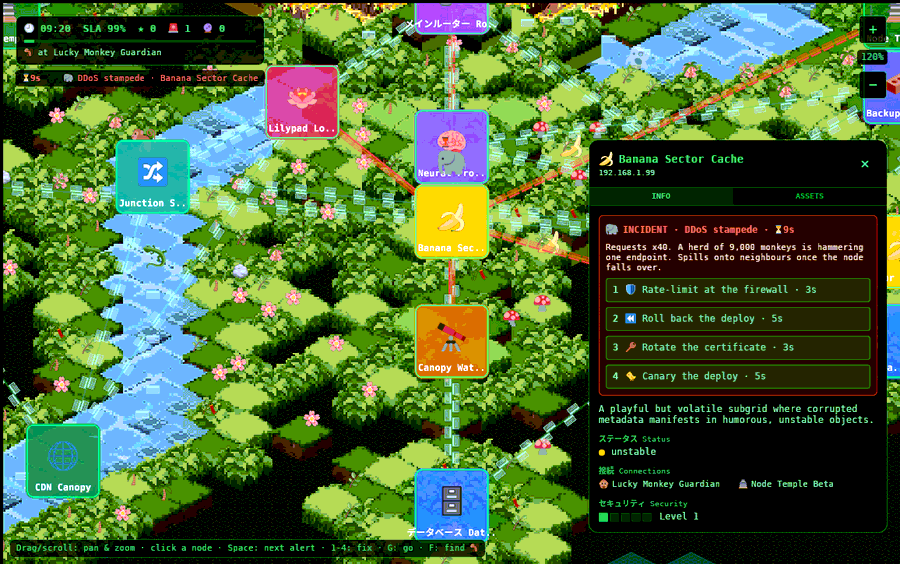
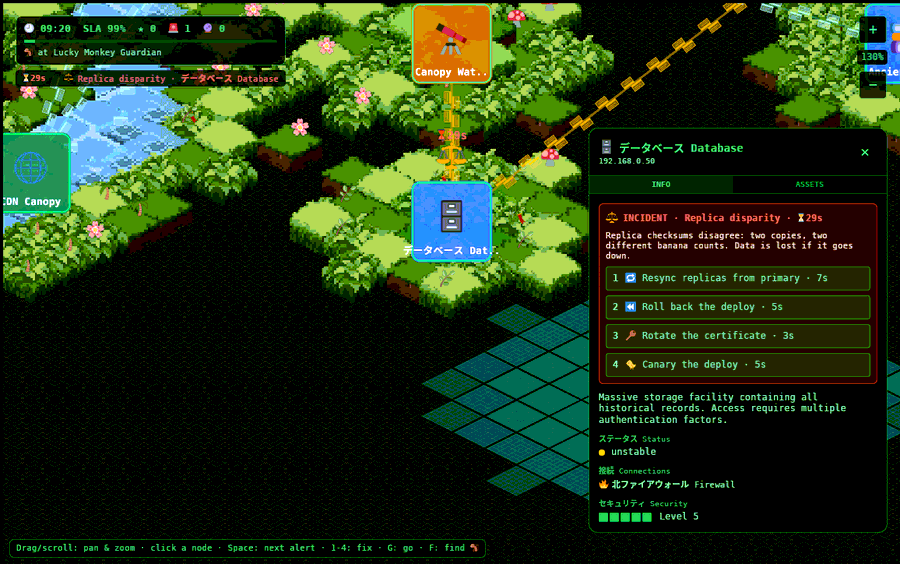
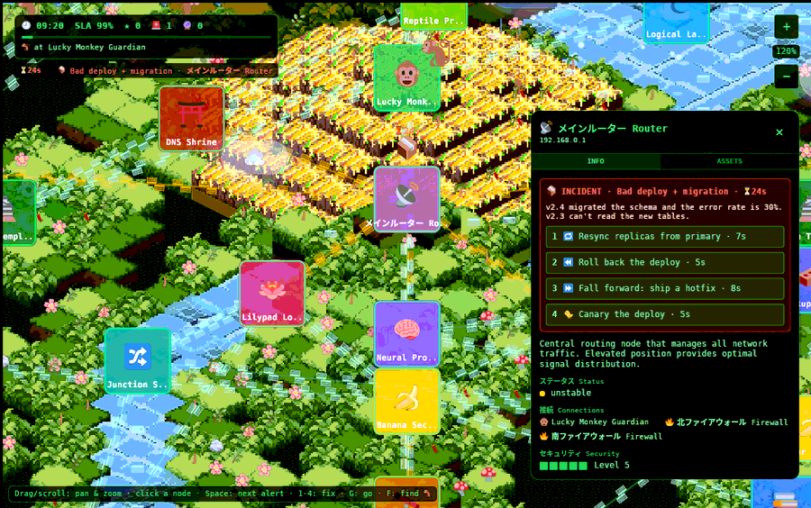
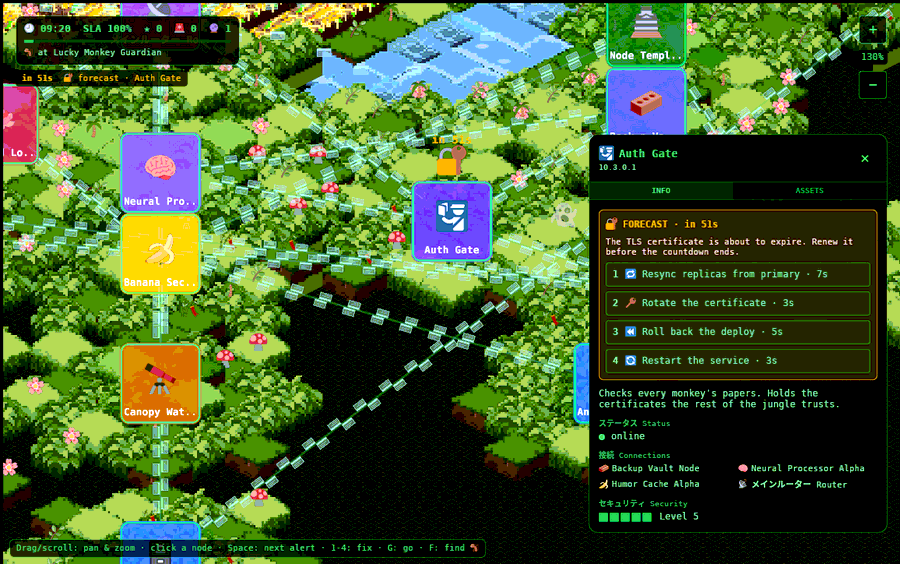

# Failure types

Every failure in the game is a jungle-dressed version of something that really
happens to production systems, and every "right fix" is the first move an
experienced operator would make. That is what makes the game more than a
reflex test: **the symptom text always contains the clue**. The three wrong
options are real tools that would be right for a *different* problem, so you
have to read.

Each section below has a **▶ live** link that opens the game with that failure
staged on a node, so you can try it while you read. The code is the
[`Failure`](source/ops.md#enum_failure) and [`Action`](source/ops.md#enum_action)
enums in `ops.rs`. The symptom text, fix, countdown and forecast for each failure
are in [`impl Failure`](source/ops.md#impl_failure). Background reading on the
fridge itself:
- [SRE: Incidents and operability](https://go.fridge.run/certs/learn/sre?n=5)
- [SRE: Reliability engineering](https://go.fridge.run/certs/learn/sre?n=4)
- [Security+: Incident response](https://go.fridge.run/certs/learn/secplus?n=4)

## At a glance

| Failure | Right fix | Can be forecast? | Spreads? | Countdown |
|---|---|---|---|---|
| 🐘 [DDoS stampede](#ddos_stampede) | 🛡️ Rate-limit at the firewall | no | yes, once down | 30 s |
| 🐛 [Worm](#worm) | 🚧 Quarantine the node | yes: 🧬 → 🩹 Patch | yes, every countdown | 35 s |
| ⚖️ [Replica disparity](#replica_disparity) | 🔁 Resync from primary | no | no (but data is lost) | 50 s |
| 📦 [Bad deploy](#bad_deploy_roll_back_or_fall_forward) | ⏪ Roll back | yes: 📅 → 🐤 Canary | no | 45 s |
| 📦 [Bad deploy + migration](#bad_deploy_roll_back_or_fall_forward) | ⏩ Fall forward (hotfix) | yes: 📅 → 🐤 Canary | no | 45 s |
| ⚡ [Lightning strike](#lightning_strike) | 🔌 Fail over to standby | no (weather) | no | 28 s |
| 🔐 [Expired certificate](#expired_certificate) | 🔑 Rotate the certificate | yes: 🔐 → 🔑 Rotate | no | 40 s |
| 🍌 [Memory leak](#memory_leak) | 🔄 Restart the service | no | no | 45 s |
| 💾 [Disk full](#disk_full) | 🧹 Clean up old snapshots | yes: 💾 → 🧹 Clean up | no | 40 s |

## DDoS stampede

🐘 → 🛡️ **Rate-limit at the firewall.** ▶ [live](https://go.fridge.run/luckymonkey#node=banana-sector&incident=ddos&zoom=1.2)

**In the game:** "Requests x40. A herd of 9,000 monkeys is hammering one
endpoint." You can *see* it: every link into the victim turns red and its frames
race inward at 300 px/s ([`fn frames`](source/ops.md#fn_frames)). Leave it, and
when the node falls over the stampede spills onto a neighbour.

**In reality:** a [distributed denial-of-service attack](https://en.wikipedia.org/wiki/Denial-of-service_attack)
sends more requests than a service can handle, from many sources at once. You
cannot fix it on the box; you have to shed the load before it arrives, with
[rate limiting](https://en.wikipedia.org/wiki/Rate_limiting) and filtering at the edge.
Restarting changes nothing (the flood continues), and failing over just moves
the target. For a real-world version of the fix, see Matt's guide on
[API keys, usage plans and the path to your servers](https://go.fridge.run/certs/learn/matt?n=4):
usage plans are exactly rate limits per client.

**Why it spreads:** an overloaded service fails, and its traffic (and every
client's retries) lands on its neighbours, which then overload too. This is a
[cascading failure](https://en.wikipedia.org/wiki/Cascading_failure), one of the
most common ways one outage becomes many.

## Worm

🐛 → 🚧 **Quarantine the node** · forecast 🧬 → 🩹 **Patch the node.** ▶ [live](https://go.fridge.run/luckymonkey#node=switch-01&incident=worm&zoom=1.3)

**In the game:** "Unknown process copying itself over every API connection."
Each time its countdown runs out, it infects a healthy neighbour, and it keeps
doing so even after its node goes down. A worm left alone eats the network.

**In reality:** a [computer worm](https://en.wikipedia.org/wiki/Computer_worm)
spreads by itself across a network through a vulnerability. The first job is
**containment**: cut the host off so it cannot spread further, then clean it.
Restarting usually brings the worm back on boot.

**The proactive version:** the Watchtower reports that a worm signature is
circulating and this node is unpatched. Patching closes the hole before the worm
arrives. This is why patch management exists, and why it is dull work that matters.

## Replica disparity

⚖️ → 🔁 **Resync replicas from primary.** ▶ [live](https://go.fridge.run/luckymonkey#node=database-cluster&incident=disparity&zoom=1.3)

**In the game:** "Replica checksums disagree: two copies, two different banana
counts." Only data stores get this: the database, banana caches, the vault, the
lake, the queue ([`fn is_store`](source/ops.md#fn_is_store)). If it goes down,
the data is gone: an extra −6% SLA, the harshest penalty in the game.

**In reality:** databases keep copies (replicas) for safety and speed. If
replication breaks, or a [split-brain](https://en.wikipedia.org/wiki/Split-brain_(computing))
lets two nodes both accept writes, the copies diverge, and reads return different
answers depending on which copy you hit. The fix is to pick the authoritative copy
(the primary) and copy it over the others. Restarting does not reconcile anything;
it can make the divergence permanent. Resync is the slowest action in the game
(7 s) because copying data is slow. The fridge's
[Data & Databases course](https://go.fridge.run/certs/t/data) covers replication.

## Bad deploy: roll back or fall forward?

📦 → ⏪ **Roll back** *or* ⏩ **Fall forward: ship a hotfix.**
▶ [live (rollback case)](https://go.fridge.run/luckymonkey#node=ai-core-01&incident=deploy&zoom=1.3) ·
▶ [live (migration case)](https://go.fridge.run/luckymonkey#node=main-router&incident=migration)

This is the scenario the game was built around. The two incidents are twins:
both say "v2.4 went out and the error rate is 30%". One sentence differs:

| Symptom says | Right move | Why |
|---|---|---|
| "**No schema change**: v2.3 is still compatible." | **Roll back** | Going back to the last known-good version is fast and safe |
| "v2.4 **migrated the schema** … v2.3 can't read the new tables." | **Fall forward** | The old code can no longer work against the changed data. Rolling back makes it worse. Fix forward with a hotfix. |

Both options are **always offered** for a bad deploy
([`fn options_for`](source/ops.md#fn_options_for) adds the twin on purpose), so
you cannot guess from the list.

**In reality:** a database migration that reshapes data is often one-way. Teams
that habitually press "rollback" learn this the hard way when the old code meets
the new schema. "Roll forward" or "fix forward" is the practice of shipping the
fix instead.

**The proactive version:** a deploy is scheduled (📅). Pushing it through a
[canary release](https://martinfowler.com/bliki/CanaryRelease.html), a small slice
of traffic first, catches a bad build before it reaches everyone. Ignore the
forecast and the deploy lands as one of the twins, 50/50, and you only find out
which when it hits.

## Lightning strike

⚡ → 🔌 **Fail over to standby.** ▶ [live](https://go.fridge.run/luckymonkey#node=volcano-core&incident=lightning&zoom=1.2)

**In the game:** "Lightning hit the rack. The primary power supply is dead." This
is the only failure the *map* causes: when a storm cloud flashes yellow, the
strike lands below it, and a node within 110 px has a 50% chance of losing power
([`clouds.rs` `storm`](source/clouds.md#fn_storm) sends a `Strike` message;
[`ops.rs` `strikes`](source/ops.md#fn_strikes) receives it).

**In reality:** hardware failure (power, disks, a whole machine). Nothing you do
on the dead box helps; you switch to redundant capacity, which is
[failover](https://en.wikipedia.org/wiki/Failover). It has the shortest countdown
(28 s) because hardware loss is abrupt.

## Expired certificate

🔐 → 🔑 **Rotate the certificate** · forecast 🔐 → 🔑 **Rotate.** ▶ [live (forecast)](https://go.fridge.run/luckymonkey#node=auth-gate&forecast=cert&zoom=1.3) · ▶ [live (expired)](https://go.fridge.run/luckymonkey#node=auth-gate&incident=cert&zoom=1.3)

**In reality:** [TLS](https://en.wikipedia.org/wiki/Transport_Layer_Security)
certificates prove a server is who it says it is, and they expire. When one lapses,
every client refuses to connect. It is the classic *completely preventable* outage,
which is why it appears both as a forecast and as an incident; the same action
renews it before expiry or replaces it after. The fridge's
[Cryptography course](https://go.fridge.run/certs/t/crypto) explains certificates.

## Memory leak

🍌 → 🔄 **Restart the service.** ▶ [live](https://go.fridge.run/luckymonkey#node=quantum-nexus&incident=leak&zoom=1.3)

**In reality:** a [memory leak](https://en.wikipedia.org/wiki/Memory_leak) is a
program that keeps memory it no longer needs, until the machine runs out and
starts swapping. A restart frees it all and buys time while someone finds the bug.
The symptom's last sentence ("Nothing else is wrong") is the clue that, this time,
the blunt fix is the right one.

## Disk full

💾 → 🧹 **Clean up old snapshots** · forecast 💾 → 🧹 **Clean up.** ▶ [live](https://go.fridge.run/luckymonkey#node=data-lake&incident=disk&zoom=1.4)

**In reality:** disks fill with logs, backups and snapshots. When a disk is full,
nothing can be written: databases stop, logs stop rotating. Freeing space is the
immediate fix; the forecast version ("85% and climbing") is what capacity alerts
are for.

## How the options are built

[`fn options_for`](source/ops.md#fn_options_for) takes the right action, adds its
twin for deploys, fills up to four with random actions from the
[11-action toolbox](source/ops.md#enum_action), and shuffles. Every distractor is
a real tool, so there is never an obviously silly answer. A wrong pick costs the
time it took, 2% SLA and 8 s off the countdown, and the option is greyed out
([`fn work`](source/ops.md#fn_work)).

## Ideas waiting to be built

The owner's brief listed "fall forward, database disparity, DDoS attack, worm,
etc."; the first four are in. Candidates that would use the new places:
- **DNS outage** at the [DNS Shrine](tour.md#the_dns_shrine): names stop resolving,
  so routes through it fail.
- **Queue backlog** at Message Queue Falls.
- **Token expiry** at the Auth Gate.
- **CDN cache poisoning** at the CDN Canopy.
- **Clock drift.**

[Extending](extending.md#add_a_failure_type) shows how to add one.

Next: [The engine](engine.md) · Back to the [documentation](index.md)
