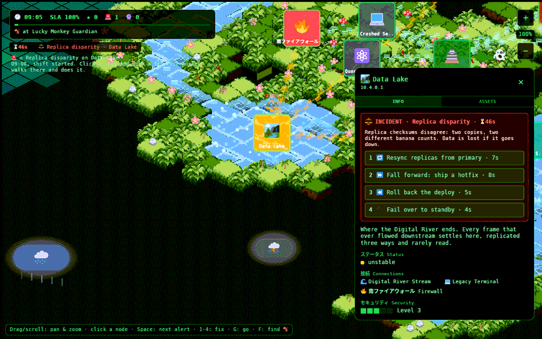

# How to play

All of this is implemented in `game/src/ops.rs`. The numbers below are the
real constants from that file, so this page doubles as the balance sheet.

## The goal

Survive one on-call **shift**, 09:00 to 17:00 on the in-game clock, with SLA
left. The shift lasts **480 real seconds** (8 minutes; one game hour per real
minute). The **SLA** (service level agreement, the promise of how much uptime
you deliver) starts at **100%**. If it reaches 0 you lose ("SLA breached"). If the
clock reaches 17:00 you win and get a bonus of **SLA × 10** points.

**Why a clock and not turns:** the first version was turn-based with a turn
timer that drained in a few seconds, which made it a reaction quiz. The owner
wanted to *move around, take action against a countdown, and be able to solve
problems proactively as well as reactively.* A day-long shift with per-problem
countdowns gives room to plan.

## Starting

1. The welcome screen ("LUCKY MONKEY MEDIA ... WARNING") is atmosphere. Press
   **PROCEED** or **Enter**.
2. You are in sandbox mode: pan, zoom, click nodes, read about them.
3. Press **START SHIFT** or **Enter** to begin. Every node is reset to online.

## You are the monkey

A 🐒 stands beside the Lucky Monkey Guardian at the start. Only the monkey can
fix things, and only where it is standing.

- **Walking:** the monkey walks along the links (API connections) at
  **240 px/s**. It takes the shortest route
  ([Dijkstra's algorithm](https://en.wikipedia.org/wiki/Dijkstra%27s_algorithm))
  and **cannot pass through a down node**, though it can walk *to* one. Links
  touching an unstable node count double length (and are walked at half speed).
- **Hiking:** if no route exists (the network is cut), the monkey walks straight
  across country at **70 px/s**. The HUD says "hiking overland".
- **Working:** every fix takes time on site (table below). A yellow bar under
  the monkey shows progress. Fixing a node that is already **down** takes
  **1.5×** as long (a cold start).
- **Ordering:** pick a fix on *any* node and the monkey walks there and then does
  it. Picking something else replaces the current order. A leg already being walked
  is finished first.

**Why travel:** it forces prioritisation. With one engineer and three alerts,
*which* you go to first, and whether a down node blocks your route, is the game.

## Incidents (reactive) 🚨

An incident breaks a node immediately: it turns **unstable** (amber, pulsing),
and a badge with the failure emoji and a countdown appears over it.

- When the countdown (its **TTL**, time to live) reaches 0 the node goes
  **down** (dark card), and its countdown restarts at **40 s**.
- **Worms** then crawl to a random healthy neighbour; **DDoS stampedes** spill
  onto a neighbour. They repeat this every time the 40 s countdown expires.
- A **replica disparity** that goes down costs an extra **6% SLA** at once (data lost).
- Other failures simply stay down, shown as **DOWN**, until fixed.

Incident TTLs (seconds from appearing to going down):

| Failure | TTL | | Failure | TTL |
|---|---|---|---|---|
| 🐘 DDoS stampede | 30 | | 🔐 Expired certificate | 40 |
| 🐛 Worm | 35 | | 🍌 Memory leak | 45 |
| ⚖️ Replica disparity | 50 | | 💾 Disk full | 40 |
| 📦 Bad deploy (either kind) | 45 | | ⚡ Lightning strike | 28 |

## Forecasts (proactive) 🔮

The **Canopy Watchtower** (🔭, monitoring) sees some trouble coming. A forecast
puts an amber badge and "in Ns" over a node that is still healthy. Do the
*preventive* action before the countdown ends and the incident never happens.
Otherwise it turns into the real incident.

| Forecast | Prevent with | If ignored becomes |
|---|---|---|
| 🔐 certificate about to expire | Rotate the certificate | Expired certificate |
| 📅 deploy scheduled | Canary the deploy | Bad deploy *or* Bad deploy + migration (50/50, revealed when it hits) |
| 💾 disk filling (data stores) | Clean up old snapshots | Disk full |
| 🧬 worm signature in the wild | Patch the node | Worm |

Forecast countdowns are **50-80 s**, long enough to plan a route.

**If the Watchtower goes down, you fly blind:** forecasts vanish from the map, the
alert list says "Watchtower down: no forecasts", and the HUD shows 🔮 `?`. The
forecasts still exist and still hit. This makes the monitoring node worth
protecting, as in real life.

## Choosing a fix

Click a node with an alert (or press **Space** to jump to the most urgent one).
The panel on the right shows the symptoms and **four options**, keys **1-4**.
Exactly one is right. For a bad deploy, both *Roll back* and *Fall forward* are
always offered, because telling them apart is the lesson (see [Failure types](failures.md)).

A **wrong** fix costs the time it took, **2% SLA**, and (for incidents) **8 s** off
the countdown. The option is greyed out so you cannot repeat it. The right fix
returns the node to online.

Work times:

| Action | Seconds | | Action | Seconds |
|---|---|---|---|---|
| 🛡️ Rate-limit at the firewall | 3 | | 🔌 Fail over to standby | 4 |
| 🚧 Quarantine the node | 2.5 | | 🔑 Rotate the certificate | 3 |
| 🔁 Resync replicas from primary | 7 | | 🔄 Restart the service | 3 |
| ⏪ Roll back the deploy | 5 | | 🐤 Canary the deploy | 5 |
| ⏩ Fall forward: ship a hotfix | 8 | | 🧹 Clean up old snapshots | 4 |
| 🩹 Patch the node | 4 | | | |

## SLA drain

Every second, the SLA loses **0.04%** per unstable node and **0.2%** per down
node. One node down for a minute costs 12%; three down for a minute cost 36%.
Wrong fixes (−2) and lost data (−6) come on top.

## How often trouble comes

- First incident at **6 s**, first forecast at **14 s**.
- Then a new **incident** every *(26 − 14p) × random(0.7-1.3)* seconds, where
  *p* is shift progress from 0 (09:00) to 1 (17:00): about every 26 s in the
  morning, every 12 s by the end of the day.
- A new **forecast** every *(30 − 14p) × random(0.7-1.3)* seconds.
- They land on a random node that is online with no alert. Data stores
  (database, banana cache, vault, lake, queue) get *replica disparity*
  (40% of their incidents) and *disk full* forecasts (50%).
- Reactive incidents otherwise are DDoS (half), worm or memory leak.
- **Lightning:** when a storm cloud flashes, the strike lands 60 px below it. If
  a node is within **110 px**, there is a **50%** chance of a lightning incident.

## Scoring ★

| Event | Points |
|---|---|
| Incident fixed | 100 + 2 × seconds left on its countdown |
| Forecast prevented | 150 |
| Shift survived | SLA × 10 |

Prevention pays more than cure because it is the behaviour to reward.

## Controls

| Input | Does |
|---|---|
| Drag (mouse or one finger) | Pan the map |
| Wheel, pinch, **+**/**−** buttons or keys | Zoom 50%-250% |
| Arrows / **WASD** | Pan |
| Click / tap a node | Select it (opens the panel) |
| Click an alert row | Select that node and fly the camera to it |
| **Space** | Most urgent alert (incidents before forecasts, then shortest countdown) |
| **1-4** | Order the monkey to do that fix on the selected node |
| **G** or "Send the monkey here" | Walk to the selected node without a fix |
| **F** | Fly the camera to the monkey |
| **Esc** | Close the panel |
| **Enter** | Proceed / start shift / new shift |

Next: [Failure types](failures.md)
