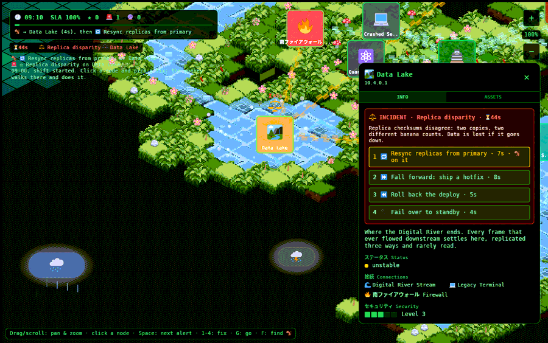
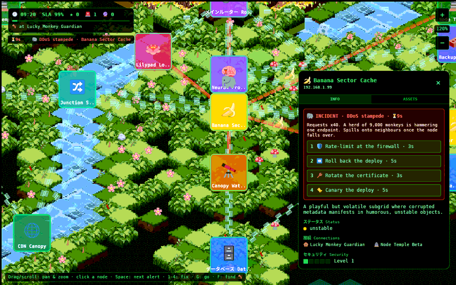
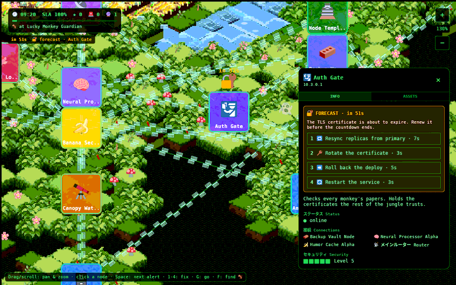

# How to play

> One monkey. One shift. Twenty-eight things that can break.

Everything on this page is implemented in [`game/src/ops.rs`](source/ops.md). The
numbers are the real constants from the code, so this page doubles as the game's
balance sheet; each number links to where it lives.

**▶ [Start a shift right now](https://go.fridge.run/luckymonkey#shift)**

## The goal

Survive one on-call **shift**, 09:00 to 17:00 on the in-game clock, with SLA left.

- The shift lasts **480 real seconds**: one game hour per real minute
  ([`SHIFT_SECS`](source/ops.md#const_shift_secs)).
- **SLA** ([service level agreement](https://en.wikipedia.org/wiki/Service-level_agreement),
  the promise of how much uptime you deliver) starts at **100%**.
- At **0** the shift is lost: "SLA breached".
- At 17:00 you win, plus a bonus of **SLA × 10** points ([`fn clock`](source/ops.md#fn_clock)).

**Why a clock and not turns:** the first version was turn-based, with a turn bar
that drained in a few seconds. That made it a reaction quiz. The owner wanted to
"move, take action with a TTL countdown … solve problems proactively, but also
have problems happen that you have to be reactive with". A day-long shift with
its own countdown on every problem gives room to plan *and* moments of panic.

## Starting

1. The welcome screen ("LUCKY MONKEY MEDIA … WARNING") is atmosphere from the
   original design. Press **PROCEED** or **Enter**.
2. You are in sandbox mode: pan, zoom, click nodes and read about them.
3. Press **START SHIFT** or **Enter**. Every node resets to online
   ([`fn start`](source/ops.md#fn_start)).

## You are the monkey

A 🐒 starts beside the Lucky Monkey Guardian. Only the monkey can fix things, and
only where it stands.

- **Walking:** along the links at **240 px/s** ([`LINK_SPEED`](source/ops.md#const_link_speed)),
  by the shortest route ([`fn route`](source/ops.md#fn_route),
  [Dijkstra's algorithm](https://en.wikipedia.org/wiki/Dijkstra%27s_algorithm);
  the fridge's [Algorithms course](https://go.fridge.run/certs/t/algo) covers it).
  - The monkey **cannot pass through a down node**, though it can walk *to* one.
  - Links touching an unstable node count double length and are walked at half speed.
- **Hiking:** if the network is cut and no route exists, the monkey walks straight
  across country at **70 px/s** ([`HIKE_SPEED`](source/ops.md#const_hike_speed)).
  The HUD says "hiking overland".
- **Working:** every fix takes time on site ([table below](#choosing_a_fix)), shown
  as a yellow bar under the monkey ([`fn monkey_token`](source/ops.md#fn_monkey_token)).
  A node that is already **down** takes **1.5×** as long: a cold start.
- **Ordering:** pick a fix on *any* node and the monkey walks there, then does it
  ([`impl Monkey`](source/ops.md#impl_monkey), [`fn walk`](source/ops.md#fn_walk),
  [`fn work`](source/ops.md#fn_work)).
  - A new order replaces the old one.
  - A leg already being walked is finished first: no teleporting.

**Why travel matters:** it forces you to prioritise. With one engineer and three
alerts, the question is *which first*, and whether a down node now blocks your
route to the others. That is the real job.

## Incidents (reactive)

🚨

An incident breaks a node immediately. The card turns **unstable** (pulsing amber),
and a badge with the failure emoji and a red countdown floats above it.

- When the countdown (**TTL**, time to live) reaches 0, the node goes **down**
  (dark card) and the countdown restarts at **40 s**.
- **Worms** then crawl to a random healthy neighbour, and **DDoS stampedes**
  spill onto one. They repeat this every time the 40 s runs out.
- **Replica disparity** that goes down costs an extra **6% SLA** at once (the data is lost).
- Anything else stays down, shown as **DOWN**, until fixed.

Countdowns ([`Failure::ttl`](source/ops.md#impl_failure)):

| Failure | TTL | | Failure | TTL |
|---|---|---|---|---|
| 🐘 DDoS stampede | 30 s | | 🔐 Expired certificate | 40 s |
| 🐛 Worm | 35 s | | 🍌 Memory leak | 45 s |
| ⚖️ Replica disparity | 50 s | | 💾 Disk full | 40 s |
| 📦 Bad deploy (either kind) | 45 s | | ⚡ Lightning strike | 28 s |

What each one means and which fix is right: [Failure types](failures.md).

## Forecasts (proactive)

🔮

The **Canopy Watchtower** (🔭, the monitoring node) sees some trouble coming. A
forecast puts an amber badge and "in 52s" over a node that is still healthy.
Do the *preventive* action before the countdown ends and the incident never
happens. Otherwise it turns into the real thing.

| Forecast | Prevent with | If ignored becomes |
|---|---|---|
| 🔐 certificate about to expire | 🔑 Rotate the certificate | Expired certificate |
| 📅 deploy scheduled | 🐤 Canary the deploy | Bad deploy *or* Bad deploy + migration (50/50, revealed when it hits) |
| 💾 disk filling (data stores) | 🧹 Clean up old snapshots | Disk full |
| 🧬 worm signature in the wild | 🩹 Patch the node | Worm |

Forecast countdowns run **50-80 s**, long enough to plan a route
([`fn forecast`](source/ops.md#fn_forecast)).

**If the Watchtower goes down, you fly blind:**
- forecasts vanish from the map;
- the alert list says "Watchtower down: no forecasts";
- the HUD shows 🔮 `?`.

The forecasts still exist and still hit ([`Net::sighted`](source/ops.md#impl_net)).
This makes the monitoring node worth protecting, which is the lesson. More on
monitoring: [SRE: Reliability engineering](https://go.fridge.run/certs/learn/sre?n=4)
and Matt's guide to
[events, monitoring and infrastructure as code](https://go.fridge.run/certs/learn/matt?n=3).

## Choosing a fix

Click a node with an alert, or press **Space** to jump to the most urgent one.
The panel on the right shows the symptoms and **four options** on keys **1-4**
([`fn alert_box`](source/ops.md#fn_alert_box)).

- Exactly one option is right.
- For a bad deploy, both *Roll back* and *Fall forward* are always offered,
  because telling them apart is the lesson ([why](failures.md#bad_deployroll_back_or_fall_forward)).
- A **wrong** fix costs the time it took, **2% SLA**, and (for incidents)
  **8 s** off the countdown. The option is greyed out so you cannot repeat it.

Work times ([`Action::secs`](source/ops.md#impl_action)):

| Action | Seconds | | Action | Seconds |
|---|---|---|---|---|
| 🛡️ Rate-limit at the firewall | 3 | | 🔌 Fail over to standby | 4 |
| 🚧 Quarantine the node | 2.5 | | 🔑 Rotate the certificate | 3 |
| 🔁 Resync replicas from primary | 7 | | 🔄 Restart the service | 3 |
| ⏪ Roll back the deploy | 5 | | 🐤 Canary the deploy | 5 |
| ⏩ Fall forward: ship a hotfix | 8 | | 🧹 Clean up old snapshots | 4 |
| 🩹 Patch the node | 4 | | | |

## The SLA drains while things are broken

Every second ([`fn clock`](source/ops.md#fn_clock)), the SLA loses:
- **0.04%** per unstable node;
- **0.2%** per down node.

One node down for a minute costs 12%; three down for a minute cost 36%. Wrong
fixes (−2) and lost data (−6) come on top.

## How often trouble comes

- First incident at **6 s**, first forecast at **14 s**.
- After that, a new **incident** every *(26 − 14p) × random(0.7-1.3)* seconds. *p* is
  shift progress, from 0 at 09:00 to 1 at 17:00. That is about every 26 s in the
  morning and every 12 s by the end of the day.
- A new **forecast** every *(30 − 14p) × random(0.7-1.3)* seconds.
- New trouble lands on a random node that is online with no alert. Data stores
  get *replica disparity* (40% of their incidents) and *disk full* forecasts (50%).
  Other incidents are DDoS (half), worm or memory leak.
- **Lightning:** a storm cloud's flash lands 60 px below it. A node within **110 px**
  has a **50%** chance of losing power ([`fn strikes`](source/ops.md#fn_strikes)).

## Scoring ★

| Event | Points | Code |
|---|---|---|
| Incident fixed | 100 + 2 × seconds left on its countdown | [`fn work`](source/ops.md#fn_work) |
| Forecast prevented | 150 | [`fn work`](source/ops.md#fn_work) |
| Shift survived | SLA × 10 | [`fn clock`](source/ops.md#fn_clock) |

Prevention pays more than cure, because it is the behaviour worth rewarding.

## Controls

| Input | Does | Code |
|---|---|---|
| Drag (mouse or one finger) | Pan the map | [`fn mouse`](source/view.md#fn_mouse), [`fn touch`](source/view.md#fn_touch) |
| Wheel, pinch, **+**/**−** buttons or keys | Zoom 50%-250% | [`fn zoom_about`](source/view.md#fn_zoom_about) |
| Arrows / **WASD** | Pan | [`fn keys`](source/view.md#fn_keys) |
| Click / tap a node | Select it (opens the panel) | [`fn pick`](source/view.md#fn_pick) |
| Click an alert row | Select that node and fly the camera to it | [`fn controls`](source/ops.md#fn_controls) |
| **Space** | Most urgent alert (incidents before forecasts, then shortest countdown) | [`fn controls`](source/ops.md#fn_controls) |
| **1-4** | Order the monkey to do that fix on the selected node | [`fn controls`](source/ops.md#fn_controls) |
| **G** or "Send the monkey here" | Walk to the selected node without a fix | [`fn controls`](source/ops.md#fn_controls) |
| **F** | Fly the camera to the monkey | [`fn follow`](source/view.md#fn_follow) |
| **Esc** | Close the panel | [`fn keys`](source/view.md#fn_keys) |
| **Enter** | Proceed / start shift / new shift | [`fn proceed`](source/ui.md#fn_proceed), [`fn controls`](source/ops.md#fn_controls) |

Next: [Failure types](failures.md) · Back to the [documentation](index.md)
