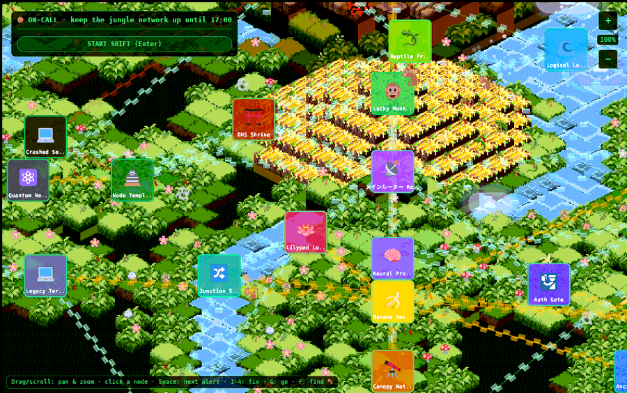

# Lucky Monkey - documentation

Lucky Monkey is a browser game about keeping a make-believe jungle-themed
computer network running. You play the on-call engineer (a monkey 🐒) through
one working shift. Things break: a herd of elephants floods an endpoint, a worm
crawls between servers, a certificate expires, a deploy goes bad. You walk to
the trouble and pick the right fix before the countdown runs out. Some trouble
you can see coming and prevent in advance. Some you can only react to.

It is live at **<https://go.fridge.run/luckymonkey>**. The code is the private
GitHub repo `LuckyMonkey/luckymonkey`, cloned on freezer in `~/Projects/luckymonkey`.

These pages explain every part of the game: what it does, how it works and
*why* it was built that way. Read them in order the first time.

| Page | What it covers |
|---|---|
| [Overview and history](overview.md) | What the game is, where it came from, how the pieces fit, repo layout |
| [How to play](gameplay.md) | The rules: shift, incidents, forecasts, the monkey, scoring, controls, every tuning number |
| [Failure types](failures.md) | Each failure, what it means in real infrastructure, the right fix and why |
| [The engine: Bevy](engine.md) | What Bevy and ECS are, how the app is assembled, schedules, states, rendering order |
| [The world](world.md) | How the map is generated and drawn: data pipeline, isometric maths, terrain, rivers, water, clouds, critters |
| [The network simulation](simulation.md) | The data model behind the game: nodes, links, health, alerts, routing, the shift clock |
| [Interface](interface.md) | Welcome screen, HUD, alert list, node panel, camera controls, and the Bevy UI traps found |
| [Build, deploy and test](build-deploy.md) | Toolchain, `tools/deploy.sh` step by step, hosting, the browser test rig, troubleshooting |
| [Outside assets and dependencies](assets.md) | Every third-party library, font, image and tool: what it is, where it comes from, licence, why it is used |
| [Decisions and known issues](decisions.md) | Why things are the way they are, bugs found and fixed, open problems, roadmap |
| [Extending the game](extending.md) | Recipes: add a node, a failure type, an action, an emoji; tune balance |

## Thirty-second summary

- **Engine:** [Bevy](https://bevyengine.org) 0.20, a Rust game engine, compiled to
  WebAssembly so it runs in the browser through WebGL2.
- **Host page:** a tiny Next.js page on the shared fridge-next runtime. It only
  loads the game into a `<canvas>`.
- **Everything is compiled in:** map data, textures and fonts are embedded in the
  `.wasm` file, so the game is two files: `luckymonkey.js` and `luckymonkey_bg.wasm`.
- **Built on fridge, not freezer:** freezer is short of disk space, so
  `tools/deploy.sh` copies the source to fridge and compiles it there.
- **The game loop** lives in one module, `game/src/ops.rs`.

Related wiki pages: [Architecture](:dev:architecture) (how requests reach the
container), [Runtimes](:dev:runtimes) and [fridge-next-runtime](:git:next-runtime:start)
(the shared Next.js image), [Deploying](:dev:deploy).
