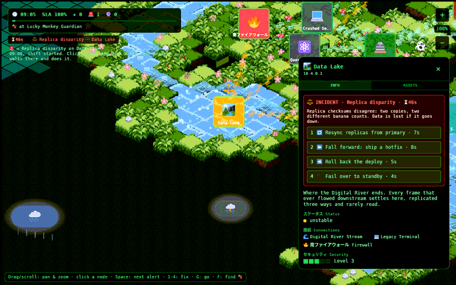

# Interface

> Black glass, green monospace, Japanese labels: the cyber-jungle terminal from
> the original design, rebuilt inside the engine.

The interface is [Bevy UI](https://docs.rs/bevy/0.20.0/bevy/?search=Node): nodes
laid out with flexbox and drawn on top of the world. The code:
- [`ui.rs`](source/ui.md): welcome screen, zoom buttons, hint bar, node panel;
- [`ops.rs`](source/ops.md): shift HUD, alert list, the panel's alert box;
- [`view.rs`](source/view.md): camera and picking;
- [`link.rs`](source/link.md): deep links.

The look follows the original v0 design:
- black panels and thin green borders;
- green [DejaVu Sans Mono](https://dejavu-fonts.github.io) text;
- Japanese section labels (ステータス Status, 接続 Connections, セキュリティ Security,
  ファイル Files) for the mood.

The colours are constants at the top of `ui.rs` (`GREEN_300` …).

## Screens

- **Welcome** ([`fn spawn_welcome`](source/ui.md#fn_spawn_welcome)): the "LUCKY
  MONKEY MEDIA / WARNING" gate from the original. The progress bar is a 0.9 s boot
  animation; everything is already loaded and the bar is there for feel. PROCEED or
  Enter moves on ([`fn proceed`](source/ui.md#fn_proceed)). The world is already
  alive behind it.
- **Playing:** everything else.

## Layout

- **Shift HUD** (top left, [`fn spawn_hud`](source/ops.md#fn_spawn_hud),
  [`fn hud`](source/ops.md#fn_hud)): clock, SLA, score, alert counts, a
  shift-progress bar (red under 30% SLA), what the monkey is doing, and
  START / NEW SHIFT.
- **Alert list** (under it, [`fn alert_list`](source/ops.md#fn_alert_list)): up to
  seven rows, incidents first, then shortest countdown. Click a row to select the
  node and fly there.
  - Rebuilt only when `Net.version` changes.
  - The countdown texts are updated every frame separately
    ([`fn live_ttls`](source/ops.md#fn_live_ttls)), so nothing is rebuilt per frame.
- **Log:** the last five events, each shown for 15 s.
- **Zoom** (top right): + / − and the percentage.
- **Hint bar** (bottom left): the keys.
- **Node panel** ([`fn panel`](source/ui.md#fn_panel)):
  - **Where:** on the **right** on screens 900 px and wider; full width at the bottom on narrow screens.
  - **INFO tab:** the alert box ([`fn alert_box`](source/ops.md#fn_alert_box)) or
    a "Send the monkey here" button, then the description, live status, connections
    and security level.
  - **ASSETS tab:** the node's fictional files.
  - **Rebuilt** when the selection, the tab or `Net.version` changes.

## Camera

[`view.rs`](source/view.md):

- **Pan:** drag with the mouse (any button) or one finger, or use the arrows/WASD
  at 600 px/s ([`fn pan`](source/view.md#fn_pan)).
- **Zoom:** 50%-250%.
  - The wheel zooms about the cursor and a pinch about its midpoint
    ([`fn zoom_about`](source/view.md#fn_zoom_about): the world point under your
    finger stays put).
  - The buttons and +/− keys zoom about the screen centre.
  - Narrow screens start at 60%.
- **Picking:** a click that moved less than 6 px selects the topmost card under
  the pointer, using an 80×80 box test with the highest z winning
  ([`fn pick`](source/view.md#fn_pick)). Screen to world:
  [`fn to_world`](source/view.md#fn_to_world).
- **Pointer over UI:** UI elements marked `Blocks` stop a press from panning or
  selecting the map underneath ([`fn pointer_over_ui`](source/ui.md#fn_pointer_over_ui)).
- **Follow:** the camera glides to a point (Space, alert rows, F, deep links),
  aiming 80 px above the node so the panel does not cover it. Any drag cancels it
  ([`fn follow`](source/view.md#fn_follow)).

## Deep links

The URL's `#hash` can open the game at a place, with trouble staged
([`link.rs`](source/link.md), parsed by [`fn parse`](source/link.md#fn_parse),
applied by [`fn apply_link`](source/ops.md#fn_apply_link)). Any deep link skips
the welcome screen.

| Hash | Does | Try |
|---|---|---|
| `#node=<id>` | fly to a node and open its panel | [`#node=data-lake`](https://go.fridge.run/luckymonkey#node=data-lake) |
| `&zoom=<0.5-2.5>` | set the zoom | [`#node=mq-falls&zoom=1.6`](https://go.fridge.run/luckymonkey#node=mq-falls&zoom=1.6) |
| `&incident=<kind>` | start a shift with that incident on that node | [`#node=banana-sector&incident=ddos`](https://go.fridge.run/luckymonkey#node=banana-sector&incident=ddos&zoom=1.2) |
| `&forecast=<kind>` | …or that forecast | [`#node=auth-gate&forecast=cert`](https://go.fridge.run/luckymonkey#node=auth-gate&forecast=cert&zoom=1.3) |
| `#shift` | skip the welcome screen and start a shift | [`#shift`](https://go.fridge.run/luckymonkey#shift) |

- **Incident kinds:** `ddos`, `worm`, `disparity`, `deploy`, `migration`,
  `lightning`, `cert`, `leak`, `disk`.
- **Forecast kinds:** `cert`, `deploy`, `disk`, `worm`.
- **Node ids:** see [the node table](assets.md#what_is_what_the_nodes).
- A staged problem gets 25 s of stage time before the day's own trouble starts.

These links are why every page in these docs can say "▶ live". They are also how
the screenshots were framed. And the hash is currently the **only** way a host page
can tell the game anything (see the [extraction report](extraction-report.md)).

## Traps found while building it

These cost real time in Bevy 0.20 on Firefox, and they explain code that might
otherwise look odd:

1. **UI box shadows broke the HUD.** When the clouds were UI nodes with
   [`BoxShadow`](https://docs.rs/bevy/0.20.0/bevy/?search=BoxShadow) glows, the HUD
   and panels rendered see-through, and a cloud with a *lower* z-index drew over the
   node panel. Moving the clouds into the world as sprites fixed it. **Avoid
   `BoxShadow` in this project.**
2. **UI background alpha renders far more transparent than set.** A black panel at
   alpha 0.85 looked about 50% transparent, so values are now 0.92-0.995. To make a
   panel look 85% opaque, set about 0.96.
3. **Nothing may sit behind the canvas.** With translucent UI, Firefox composited
   the page behind the canvas, and even stale frames, into the panels. So the host
   page ([`page.tsx`](source/page-tsx.md)) removes its "Generating World" text once
   the game starts, the canvas has a black background, and the window uses
   `composite_alpha_mode: Opaque` ([`fn main`](source/main.md#fn_main)).
4. **Do not pre-create the WebGL context with `alpha: false`** before Bevy starts,
   a common trick. It made the transparency worse here, and it was reverted.
5. **Emoji need the font subset.** Text only renders glyphs present in the
   embedded fonts. A new emoji in code shows as a box until the fonts are
   re-subset with [`tools/subset-fonts.py`](source/subset-fonts.md)
   ([Extending](extending.md#add_an_emoji_or_any_non-ascii_text)).

Next: [Build, deploy and test](build-deploy.md) · Back to the [documentation](index.md)
