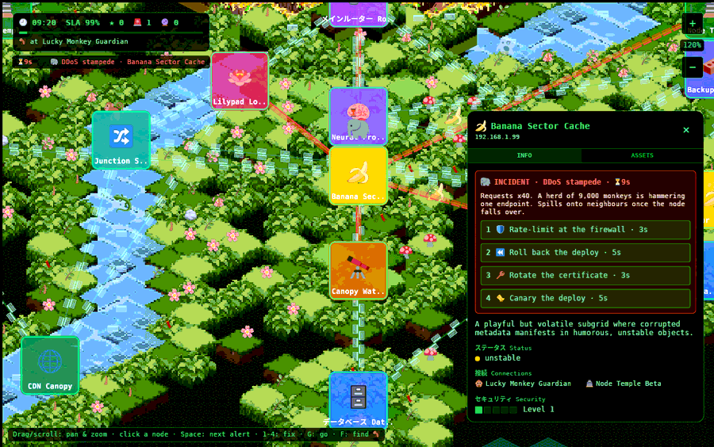

# The network simulation

> The map is the stage; this is the play. Under the jungle there is a graph, a
> clock, and one monkey with a to-do list.

Everything here lives in [`game/src/ops.rs`](source/ops.md). This page explains the
data model and the algorithms; [How to play](gameplay.md) has the rules and numbers.

## The state of the world, in four resources

### [`Net`](source/ops.md#struct_net): the network

| Field | Meaning |
|---|---|
| `health` | per node: `Online`, `Degraded` (shown "unstable") or `Down` ("offline") ([`enum Health`](source/ops.md#enum_health)) |
| `alerts` | per node: at most one open [`Alert`](source/ops.md#struct_alert) |
| `links` | each connection once, as a pair of node indices, smaller first |
| `neighbours` | adjacency lists built from `links` |
| `at` | screen position of each node card |
| `kinds`, `names` | node type (decides which failures can hit) and display name |
| `watchtower` | index of the monitoring node (forecasts are visible only while it is up) |
| `queued` | the fix the monkey is heading to do, for the panel's highlight |
| `version` | bumped on every change; UI rebuilds only when it changes |

**Links come from the node data** ([`fn setup_net`](source/ops.md#fn_setup_net)).
Each node lists `connections` by id, and these become an undirected
[graph](https://en.wikipedia.org/wiki/Graph_(discrete_mathematics)) of 44 edges.
Unknown ids are skipped (the original data references a `firewall-01` that does
not exist), and duplicates are dropped.

**Why one alert per node:** it keeps the badge and panel readable. A node already
in trouble cannot pick up a second problem, which stops pile-ups no one could follow.

### [`Alert`](source/ops.md#struct_alert)

| Field | Meaning |
|---|---|
| `failure` | which [`Failure`](source/ops.md#enum_failure) |
| `forecast` | true = not broken yet (a Watchtower forecast) |
| `ttl` | seconds until it hits (forecast) or gets worse (incident) |
| `options` | the four [`Action`](source/ops.md#enum_action)s offered, shuffled |
| `tried` | bitmask of options already tried and found wrong |
| `since` | shift time it appeared; also its identity |

[`Alert::right()`](source/ops.md#impl_alert) is the correct action: the failure's
fix, or, for a forecast, its preventive action.

### [`Shift`](source/ops.md#struct_shift)

The phase (Idle / Running / Won / Lost), the clock (seconds since 09:00), SLA,
score, fixes, prevented, when the next incident and forecast are due, and the last
five log lines.

### [`Monkey`](source/ops.md#struct_monkey)

Where it is (`at`), where it is going (`path`), progress along the current leg,
whether the leg is a cross-country hike, its `job` (the ordered fix:
[`struct Job`](source/ops.md#struct_job)), and its screen position for drawing.

## One frame, step by step

While a shift runs, eight systems run **chained**, in this order, every frame
([`ops::plugin`](source/ops.md#fn_plugin)):

1. **[`controls`](source/ops.md#fn_controls)**: input.
   - Enter starts a shift.
   - Alert rows and Space select a node and fly the camera to it.
   - G sends the monkey.
   - 1-4 or a fix button creates a `Job` and calls [`Monkey::send`](source/ops.md#impl_monkey).
2. **[`walk`](source/ops.md#fn_walk)**: moves the monkey along its path at 240 px/s
   on links or 70 overland, halved if either end of the leg is unstable. Leftover
   time carries into the next leg, so a slow frame never overshoots.
3. **[`work`](source/ops.md#fn_work)**: if the monkey is at its job's node and not
   walking, counts down the work. At zero it checks the *same alert* is still there
   (matching `since`; it may have been replaced).
   - Right: alert cleared, node online, points.
   - Wrong: option greyed, −2 SLA, −8 s countdown.
4. **[`clock`](source/ops.md#fn_clock)**: the heart of the game. It advances the
   clock, then:
   - counts down every alert. An expired **forecast** becomes its incident (a
     deploy forecast decides rollback-type or migration-type now, 50/50). An
     expired **incident** puts the node down, resets its countdown to 40 s,
     charges −6 for lost data, and queues worm and DDoS spread;
   - spreads: each spreader infects one random online, alert-free neighbour;
   - drains the SLA for unstable and down nodes;
   - raises new incidents and forecasts on schedule;
   - checks for win and loss.
5. **[`strikes`](source/ops.md#fn_strikes)**: reads [`Strike`](source/clouds.md#struct_strike)
   messages from storm clouds and may raise a lightning incident on the nearest node.
6. **[`hud`](source/ops.md#fn_hud), [`alert_list`](source/ops.md#fn_alert_list),
   [`live_ttls`](source/ops.md#fn_live_ttls)**: redraw the interface from the
   final state.

Why chained? Because then a frame is deterministic: input, movement, work, time,
weather, display. A fix that completes on the same frame its countdown runs out is
always resolved the same way.

## Routing: how the monkey finds its way

[`fn route`](source/ops.md#fn_route) is
[Dijkstra's shortest-path algorithm](https://en.wikipedia.org/wiki/Dijkstra%27s_algorithm),
written plainly. With 28 nodes, the simple "pick the closest unvisited node"
loop, with no priority queue, is instant.

- **Cost:** an edge costs the screen distance between the two cards, **×2 if
  either end is unstable**.
- **Down nodes:** one can be the **destination but not a waypoint**. The search
  never expands from a down node, except the starting one.
- **No route:** `None`, and [`Monkey::send`](source/ops.md#impl_monkey) plans a
  single overland leg straight to the target instead.

[`fn eta`](source/ops.md#fn_eta) adds up the remaining legs at their speeds for
the HUD's "→ DNS Shrine (3s)".

**Why route on the network and not across the terrain:** the network is the
point. When a down node cuts off half the map, you either fix the blocker first or
take the slow way round. That is a real-world dilemma (you cannot SSH through a
dead jump host) in a form you can play.

## Escalation and spread

    forecast ──(preventive fix in time)──▶ prevented (+150)
       │ 50-80 s pass
       ▼
    incident: node unstable ──(right fix)──▶ online (+100 + 2 × seconds left)
       │ countdown runs out
       ▼
    node down (countdown resets to 40 s; disparity: −6 SLA)
       │ every further 40 s: worm / DDoS infect a neighbour
       └──(right fix, 1.5× work time)──▶ online

This is a toy model of [cascading failure](https://en.wikipedia.org/wiki/Cascading_failure):
one unattended problem becomes several. The fridge's SRE course has the real version:
[Incidents and operability](https://go.fridge.run/certs/learn/sre?n=5).

## Visual feedback driven by the model

Everything you see on the links and cards is computed every frame from `Net`:

**Link lines** ([`fn links`](source/ops.md#fn_links)):

| Link state | Line |
|---|---|
| both ends online | faint green |
| either end unstable | amber |
| either end down | dim red |

**Data frames** ([`fn frames`](source/ops.md#fn_frames)):
- about one frame per 34 px of link in each direction;
- two lanes, keeping right, 4 px apart, so the directions don't overlap;
- each frame turned to face along the link and kept clear of the cards at both ends.

| Link state | Frames |
|---|---|
| online | 60 px/s, pale green |
| unstable | 25 px/s, amber |
| down | stopped, dim red |
| **DDoS** on either end | every frame red, racing *toward* the victim at 300 px/s: the flood is visible |

**Cards** ([`fn cards`](source/ops.md#fn_cards)):
- colour by health;
- a bobbing badge with the failure or forecast emoji;
- the countdown under it: red "⏳12s" for incidents, amber "in 52s" for forecasts,
  "DOWN" when there is nothing left to count.

Forecast badges hide while the Watchtower is down.

**The monkey** ([`fn monkey_token`](source/ops.md#fn_monkey_token)): 🐒 beside the
card, hopping while it walks, with a yellow progress bar while it works.

**Popups** ([`fn popups`](source/ops.md#fn_popups)): "fixed +130", "prevented
+150" and "✗ didn't help" float up and fade over 2 s.

Next: [Interface](interface.md) · Back to the [documentation](index.md)
