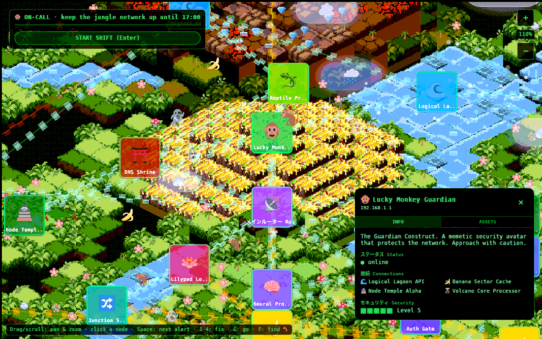
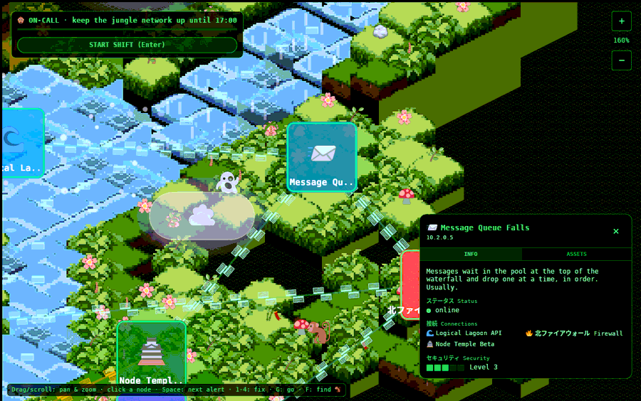
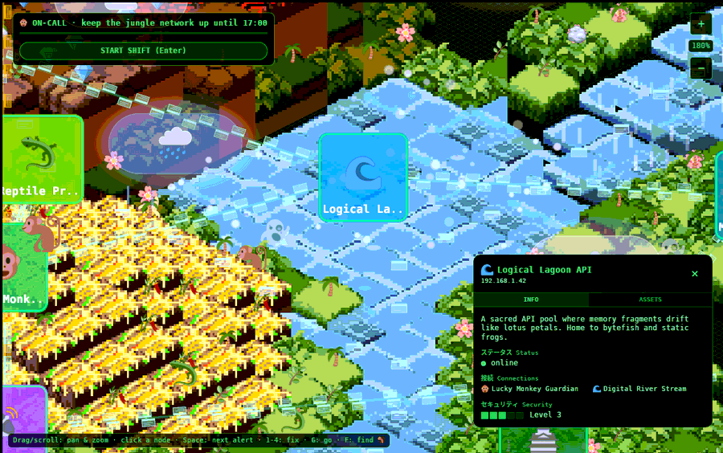

# The world

> How 1,100 little blocks of grass, water and lava become a jungle floating in
> the void: the data, the maths, and the tricks.



## From TypeScript to the wasm: the map's journey

The map is still *defined* in the original TypeScript,
[`lib/world-data.ts`](source/world-data.md), with the critter roster in
[`lib/npc-data.ts`](source/npc-data.md). Rather than rewrite those generators in
Rust, [`tools/export-world.cjs`](source/export-world.md) runs them and writes JSON:

    lib/world-data.ts ──(TypeScript compiler, in memory)──▶ run ──▶ game/assets/world.json
    lib/npc-data.ts   ─────────────────────────────────────────────▶ game/assets/npcs.json

The export borrows the [TypeScript](https://www.typescriptlang.org) compiler from
the [shared fridge-next runtime](:git:next-runtime:start) to transpile each file
and runs it in Node. `world.json` (117 KB) holds:

| Field | Contents |
|---|---|
| `tiles` | every cell `{x, y, type, height}`, plus `fall` (waterfall) and `lagoon` flags |
| `nodes` | the 28 nodes: id, name, type, IP, emoji, description, position, connections, status, security level, assets |
| `decorations` | trees, flowers, crystals… `{type, position}` |
| `streams` | the two river centrelines (main river, Digital River), upstream first |

At startup Rust parses it with [serde](https://serde.rs) from
`include_str!`, which bakes the file into the binary at compile time
([`world::plugin`](source/world.md#fn_plugin); the types are
[`WorldFile`](source/world.md#struct_worldfile),
[`NodeData`](source/world.md#struct_nodedata), [`Tile`](source/world.md#struct_tile)).

**Why keep TypeScript as the source:** it was the existing, working map, built from
a seeded generator. Porting it would have risked a different world for no gain;
the export keeps one source of truth. The seed is **8675309**, so the world is
identical every time.

## The isometric maths

The whole projection is one function, [`fn iso`](source/world.md#fn_iso):

```rust
pub fn iso(x: f32, y: f32, h: f32) -> Vec2 {
    Vec2::new((x - y) * TILE_W / 2.0, -((x + y) * TILE_H / 2.0) + h * ELEV)
}
```

With `TILE_W = 64`, `TILE_H = 32` and `ELEV = 16`:
- a tile's top is a 64×32 diamond (the classic 2:1 isometric ratio);
- each unit of height lifts it 16 px;
- Bevy's y axis points up, hence the minus.

**Worked example:** the Guardian on the pyramid summit at grid (17, 17), height 5:
x = (17−17)·32 = 0, y = −(34)·16 + 5·16 = **−464**. A classic explanation of the
idea: [Isometric tiles math](https://clintbellanger.net/articles/isometric_math/).
The reverse (screen → grid) is worked out in the
[extraction report §4](extraction-report.md#world_grid_inverse).

## Tiles, and the alignment bug that started it all



The tile pictures ([`public/sprites/*.png`](assets.md#images)) are **32×32
isometric blocks**: the top diamond fills rows 8-24, and an 8 px side "skirt"
hangs below.

[`tools/make-textures.py`](source/make-textures.md) packs the 15 sprites plus one
white cell into a single 4×4 [texture atlas](https://en.wikipedia.org/wiki/Texture_atlas)
(`tiles.png`, 136×136):
- each 32 px cell is padded to 34 px by copying its edge pixels outwards, so a
  neighbour never bleeds in when the GPU samples at a cell's edge;
- [`fn cell_uv`](source/world.md#fn_cell_uv) finds a cell's coordinates in the atlas;
- [`fn atlas_cell`](source/world.md#fn_atlas_cell) picks a variant per cell with a
  stable hash ([`fn cell_hash`](source/world.md#fn_cell_hash)), so the same cell
  always gets the same grass.

The sprites are drawn **at 2×** (64×64), so the diamond lands exactly on the
64×32 grid cell. **The old Pixi.js version squashed them into 64×32 rectangles**,
which distorted every diamond so the tiles never met. That was the "tile alignment"
problem the owner wanted fixed, and fixing it properly was part of the case for
the port.

Tile kinds ([`mod kind`](source/world.md#mod_kind)): grass (4 variants), water (5),
platform (tinted grass), scorched (tinted), volcano/lava (5), temple gold.

## The terrain mesh

[`fn spawn_terrain`](source/world.md#fn_spawn_terrain) builds one mesh per diagonal
row (x + y) using a small vertex buffer helper, [`MeshBuf`](source/world.md#struct_meshbuf).
For each cell it adds:

- **Two front walls**, one for each visible side. Each drops to the neighbour in
  front, or down to the bottom of the island slab (one unit below the ground) when
  there is no neighbour. Walls are vertex-coloured by kind
  ([`fn wall_color`](source/world.md#fn_wall_color)), and the left wall is drawn
  darker, which reads as light coming from the right.
- **The top sprite**, as a quad textured from the atlas.

Taller tiles are tinted slightly brighter ([`fn top_tint`](source/world.md#fn_top_tint)),
so terraces read at a glance. Then each row's mesh is placed at z = x + y.
[Why that works](engine.md#renderingdepth_in_a_2d_isometric_world).

## Clean-ups applied when loading

The TypeScript generators have quirks. [`world::plugin`](source/world.md#fn_plugin)
repairs them as it loads:

- **Duplicates:** several generators write the same cell. The **tallest wins**, so
  stacked platforms read as solid ground. Water keeps its waterfall and lagoon flags.
- **The upside-down pyramid:** the temple generator gave the widest layer the
  greatest height. The loader rebuilds it as a stepped pyramid: height =
  6 − (the lowest layer covering the cell). The centre, where the Guardian sits,
  becomes the summit.
  ▶ [see it](https://go.fridge.run/luckymonkey#node=monkey-statue&zoom=1.1)
- **The floating river:** the river was generated alone and looked like it floated
  in the void. Every water cell now gets:
  - a full ring of grass around it, at the water's height;
  - a *ragged* second ring (45% of cells, chosen by hash), so the edge is not a ruler line;
  - a bush, tree, flower, bamboo or rock on 22% of the new bank cells.

  It deliberately stops there: the owner wants the void visible.

## The rivers

- The **main river** starts at a waterfall at the top (x 20, y −5, height 5) and
  steps down to height 0. It runs south through bends to a delta at y 45, where the
  CDN Canopy stands. The Logical Lagoon joins it at (17, 7).
  ▶ [the waterfall](https://go.fridge.run/luckymonkey#node=mq-falls&zoom=1.6)
- The **Digital River** leaves the small lagoon at (7, 12), runs down the west edge
  (x = 1), and bends east into the **Data Lake** at (11, 38). It also includes the
  channel from the main river along y = 12.
  ▶ [the Data Lake](https://go.fridge.run/luckymonkey#node=data-lake&zoom=1.4)

Both rivers are three tiles wide. Their centrelines are exported as `streams`
for the floating frames below.

## Water effects



[`water.rs`](source/water.md) restores the original v0 canvas animation:

| Effect | What it does | Code |
|---|---|---|
| Waterfall streams | three white streaks per waterfall tile pour down once a second | [`fn spawn`](source/water.md#fn_spawn), [`fn animate`](source/water.md#fn_animate) |
| Lagoon bubbles | on 60% of lagoon tiles, two bubbles rise 20 px and pop over 3 s (the original CSS `bubble` keyframes), wobbling | [`fn animate`](source/water.md#fn_animate) |
| Glints | small white flashes on 30% of river tiles, each with its own rhythm | [`fn animate`](source/water.md#fn_animate) |
| **Data frames on the rivers** | a frame every 46 px of river, floating downstream at 38 px/s, bobbing, fading in at the source and out at the mouth; depth recomputed every frame so frames slip behind banks | [`struct Line`](source/water.md#struct_line), [`fn flow`](source/water.md#fn_flow) |

## Decorations, edge islands and the void

- **Decorations** are emoji rendered as text
  ([`fn spawn_decorations`](source/world.md#fn_spawn_decorations),
  [`fn emoji_text`](source/world.md#fn_emoji_text)): 🌴 🌸 🌿 💎 🎋 🍄 🪷 🪨.
  Lotus grows only on water and everything else only on land. A small hashed jitter
  stops them sitting in a perfect grid.
- **Edge islands:** ten faint teal diamond clusters float at the map's edges
  ([`fn spawn_islands`](source/world.md#fn_spawn_islands)), suggesting more network beyond.
- **The void:** `grid_background.png` is tiled behind everything at 35% opacity
  ([`fn spawn_backdrop`](source/world.md#fn_spawn_backdrop)).

## Node cards

Each node is an 80×80 rounded card ([`fn spawn_nodes`](source/world.md#fn_spawn_nodes)):
- a `card.png` tinted by node type ([`fn node_color`](source/world.md#fn_node_color));
- a green outline;
- its emoji;
- a name label, cut to 10 characters plus "..".

It stands at the node's ground height. The game adds an alert badge and countdown
as children ([Simulation](simulation.md#visual_feedback_driven_by_the_model)). Card
colour follows health: normal, pulsing amber (unstable), dark red-brown (down).

## Critters

[`npc.rs`](source/npc.md): 26 critters from the roster.

- **Movement:** logic ticks every **80 ms**, as in the original
  ([`fn tick`](source/npc.md#fn_tick)). Each tick a critter steps in one of eight
  directions, turns around at the map edge or impassable terrain, and sometimes
  picks a new heading (monkeys 2%, lizards 3%, ghosts and bananas 5%, crocodiles 1%).
- **Where they go:** lizards and crocodiles stay on water; bananas go anywhere.
- **Smooth motion:** between ticks, the sprite glides toward its logical position
  ([`fn place`](source/npc.md#fn_place)).
- **Lifespan:** each fades in, lives 30, 60 or 90 s, then fades out. Up to 20 are
  alive at once.
- **Style:** ghosts bob and pulse translucent; bananas bounce.

## Clouds

Ten clouds: fair ☁️, rain 🌧️ and storm ⛈️. They are drawn like the original HTML
`<div>`s the owner liked: a translucent rounded **pill** with a 1 px border and the
emoji inside, in three sizes (80×40, 120×55, 160×75).

- They drift on one wind (right and slightly down) at 10-24 px/s and wrap around,
  so the sky never empties ([`fn drift`](source/clouds.md#fn_drift)).
- Rain clouds drop five streaks: the original `rain-drop` keyframes
  ([`fn rain`](source/clouds.md#fn_rain)).
- Storm clouds flash every 4-9 s ([`fn storm`](source/clouds.md#fn_storm)). Over
  0.6 s the pill ramps to yellow, a yellow glow swells behind it, and ⚡ appears.
  At the peak a [`Strike`](source/clouds.md#struct_strike) message goes out, which
  [can knock out a node](failures.md#lightning_strike).

**Their history is a small saga.** The port first replaced the divs with
"realistic" textured clouds with ground shadows. The owner said those lost the
charm, so the pill style came back as Bevy UI nodes, which broke the HUD's
rendering. Then they became world sprites. See [Decisions](decisions.md#design_decisions).

Next: [The network simulation](simulation.md) · Back to the [documentation](index.md)
